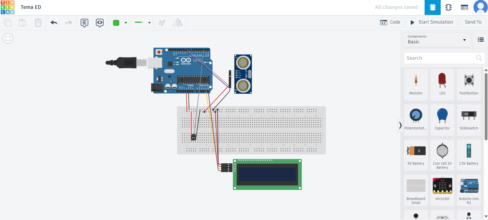

# Arduino Temperature and Distance Monitor

An Arduino Uno project that reads ambient temperature with a TMP36 sensor and distance with an HC-SR04 ultrasonic sensor, then updates a 16×2 I2C LCD every second.

## Hardware and wiring

- Arduino Uno, TMP36, HC-SR04, 16×2 I2C LCD, breadboard, and jumper wires
- TMP36 analog output → `A0`
- HC-SR04 trigger → digital pin `9`; echo → digital pin `10`
- LCD connected over I2C, as shown in the circuit image

The sketch converts the TMP36 voltage to degrees Celsius and the echo pulse duration to centimetres. It requires the `Adafruit_LiquidCrystal` library used by the original Tinkercad circuit. Check the LCD address and wiring when using a different physical module.

## Run

1. Open `Arduino_Temperature_Distance_Monitor.ino` in Arduino IDE or Tinkercad Circuits.
2. Install or select the `Adafruit_LiquidCrystal` library if your environment requires it.
3. Select an Arduino Uno, connect the components as shown, and upload the sketch.

The [physical prototype video](media/physical-demo.mov) shows the project in operation. The source archive also contained a Tinkercad edit link; this README does not publish that editable share link.
