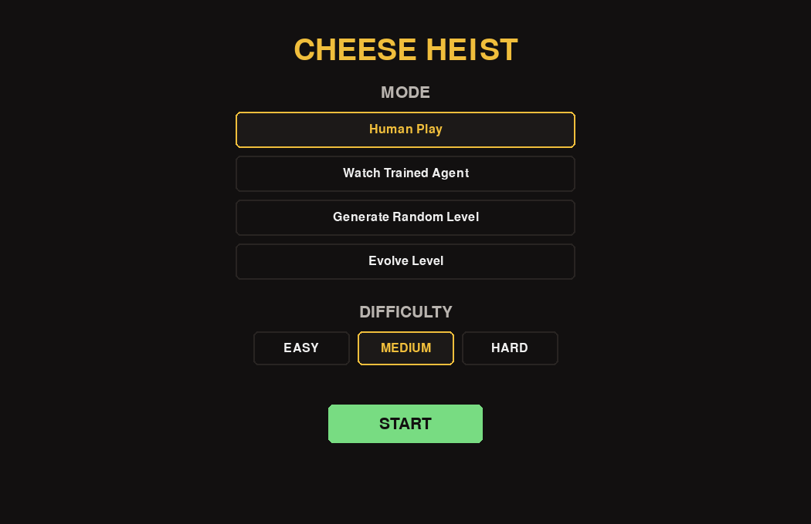

# Cheese Heist

Cheese Heist is a Python/Pygame maze game. Guide a mouse through a generated maze, collect the cheese, avoid traps, and return home. Alongside manual play, the project explores level difficulty, genetic level evolution, and a Q-learning agent.

| Main menu | Generated maze |
| --- | --- |
|  |  |

## What it includes

- Procedural maze generation with recursive backtracking and BFS validation.
- Easy, medium, and hard difficulty based on path length, dead ends, intersections, wall density, and traps.
- A genetic algorithm that evolves a level toward the selected difficulty.
- A Q-learning agent that can be trained and watched in the game.
- A comparison between the shortest BFS route and the learned policy, plus training statistics.

## Game modes

| Mode | What happens |
| --- | --- |
| **Human Play** | Generate a level at the selected difficulty and play it yourself. |
| **Watch Trained Agent** | Generate a level, train the agent, and watch the learned policy. Training can take a while. |
| **Generate Random Level** | Play a procedural level without difficulty filtering. |
| **Evolve Level** | Evolve a level toward the selected difficulty, then play the result. |

Use the arrow keys and `Enter`, or the mouse, in the main menu.

## Controls

| Key | Action |
| --- | --- |
| `WASD` or arrow keys | Move the mouse |
| `B` | Show the BFS and Q-learning paths |
| `R` | Regenerate the current mode |
| `M` | Return to the main menu |
| `Esc` | Quit |

## Install and run

Use Python 3 with `pip`. In a terminal opened in this folder:

```sh
python -m venv .venv
```

Activate the environment with `.venv\Scripts\activate` on Windows or `source .venv/bin/activate` on Linux/macOS, then run:

```sh
python -m pip install -r requirements.txt
python main.py
```

The `Makefile` also provides `make setup`, `make run`, and `make test` on Linux/macOS.

## Tests

```sh
python -m pytest tests -v
```

## How the algorithms work

The difficulty score combines the shortest route, dead ends, intersections, wall density, and trap placement. Default thresholds for a 15 × 21 maze are below `29` for easy, `29` to below `32` for medium, and `32` or above for hard.

The genetic algorithm uses tournament selection, elitism, horizontal or vertical crossover, and mutations to walls, corridors, goals, and traps. Generated levels are validated before use. In **Evolve Level**, the final level and fitness history are saved under `data/generated_levels/` and `data/results/`.

The Q-learning state is `(mouse_row, mouse_column, has_cheese)` and its actions are up, down, left, and right. Training output, including reward, step count, success rate, and comparison with BFS, is written under `data/results/`; the Q-table is stored under `data/saved_models/`. These files are generated locally and ignored by Git.

## Project layout

```text
assets/       Sprites and tiles
config/       Game settings
core/         Main loop and game rules
difficulty/   Difficulty metrics and genetic algorithm
entities/     Mouse, cheese, and traps
generation/   Maze generation, validation, and BFS
graphics/     Rendering and menu
learning/     Q-learning environment, agent, and training
tests/        Automated tests
main.py       Entry point
```

## Authors

- Andreea Radu
- David Silviu

Cheese Heist was developed as a collaborative project. The original repository is [Andreea21Radu/CheeseHeist](https://github.com/Andreea21Radu/CheeseHeist).
