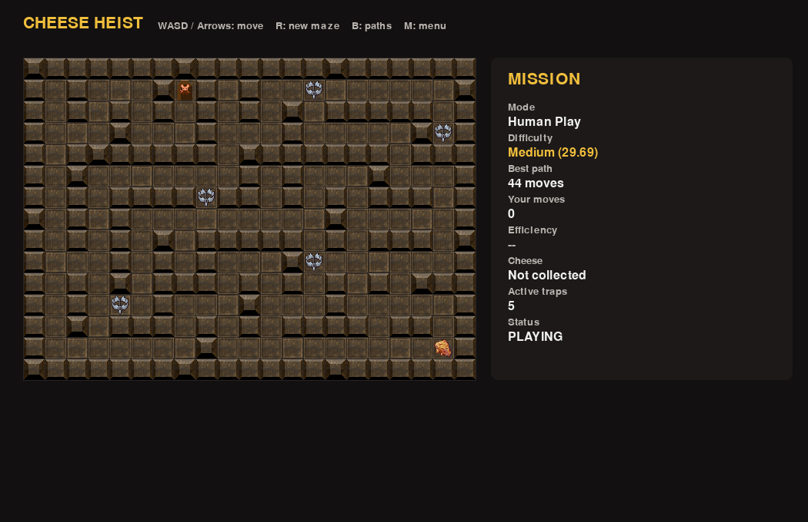
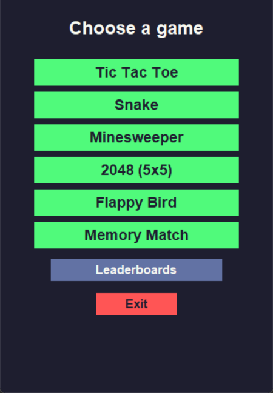

# Projects

A collection of university coursework and personal software projects by [David Silviu](https://github.com/davidsilviu005). The work spans algorithms, desktop applications, systems programming, simulations, and game development.

## Start here

| Project | What it demonstrates | Stack |
| --- | --- | --- |
| [Cheese Heist](CheeseHeist/) | A playable maze game with procedural generation, genetic level evolution, and a Q-learning agent | Python, Pygame |
| [Chess](chess/) | A C++ move engine and minimax opponent with a Pygame interface | C++, Python, Pygame |
| [IPv4 Router](IPv4_Router_Trie_ARP_ICMP/) | Packet forwarding with trie-based routing, ARP resolution, and ICMP responses | C, Linux |
| [Reliable UDP Transport](Reliable_UDP_Transport_CPP/) | A UDP reliability layer with acknowledgments, retransmission, and ordered delivery | C++, Linux |
| [Smart Study Assistant](Smart_Assistant/) | A desktop task and notes organizer with local storage and optional note summarization | Python, Tkinter, SQLite |
| [Energy Network Simulation](Simulation_of_Energy_Network/) | A command-driven power grid model with producers, consumers, batteries, and blackouts | Java |
| [Python Games Interface](Python_Games_interface/) | A desktop launcher for six small games, with local leaderboards | Python, Tkinter |
| [RGD Horror Story](Horror_Game/) | First-person horror mechanics built with a five-person team; **in development, without a finished playable level** | Unity, C# |

Open a project folder for its code, features, and setup instructions. The projects are independent; there is no single build command for this repository.

## Previews

**Cheese Heist — generated maze and gameplay view**

| Python Games Interface | Smart Study Assistant |
| --- | --- |
|  |  |

Screenshots were captured from the running applications. The study assistant preview uses demonstration data.

## All projects

### Applications and games

- [Cheese Heist](CheeseHeist/) — a procedural maze game with manual play and algorithmic game modes, built with Andreea Radu.
- [Chess](chess/) — C++ chess engine with a Python interface.
- [Smart Study Assistant](Smart_Assistant/) — desktop tasks, notes, and optional AI summarization.
- [Python Games Interface](Python_Games_interface/) — a launcher for Tic Tac Toe, Snake, Minesweeper, 2048, Flappy Bird, and Memory Match.
- [RGD Horror Story](Horror_Game/) — Unity horror game systems, developed by a team of five; currently a work in progress.
- [CLI Games in C](CLI_Games_In_C/) — terminal games written in C.
- [Slots Machine](Slots_machine/) — slot machine program in C.

### Networking and systems

- [IPv4 Router with Trie-Based Routing](IPv4_Router_Trie_ARP_ICMP/) — Linux router with longest-prefix matching, ARP resolution, packet queueing, and ICMP responses.
- [Reliable UDP Transport Layer](Reliable_UDP_Transport_CPP/) — C++ sender and receiver library with a working loopback demo.

### Algorithms and simulations

- [Energy Network Simulation](Simulation_of_Energy_Network/) — Java simulation of an energy grid.
- [Data Structures Implementations](DSA_Structures_Implementations/) — C data structure exercises.
- [Design Patterns Implementation](Design_Patterns_Implementation/) — examples of object-oriented design patterns.
- [School Database and Exams Processing](School_Database_Exams_Processing/) — data processing coursework.
- [Spam Detector Machine](Spam_Detector_Machine/) — spam classification project.
- [Working with Data in MATLAB](Working_With_Data_Matlab/) — data analysis exercises.
- [Minecraft Theme: Chunk Gravity Processing](Minecraft_Theme_Chunk_Gravity_Processing/) — chunk processing coursework.
- [Browser](Browser/) — C programming coursework.

### Functional programming

- [Checkout Queue Simulation](Racket_Checkout_Queue_Simulation/) — four Racket stages covering customer assignment, time progression, queue abstraction, and counter opening or closing.
- [Graph Algorithms and Algebraic Graphs](Haskell_Graph_Algorithms/) — four Haskell stages covering traversal, algebraic graphs, modular decomposition, and folds.

### Embedded systems

- [Arduino Temperature and Distance Monitor](Arduino_Temperature_Distance_Monitor/) — reads TMP36 and HC-SR04 sensors and displays measurements on an LCD.

### Low-level programming

- [Assembly Commands Conversion in C](Assembly_Commands_Conversion_C/) — conversion exercises.
- [Assembly Functions: Fibonacci and Palindrome](Assembly_Functions_kFibonacci_Palindrome/) — assembly routines.
- [Assembly Struct Walkthrough and Sudoku Checker](Assembly_Struct_Walkthrough_and_Sudoku_Checker/) — assembly exercises.

## About

I'm a computer science student interested in software development, algorithms, and building practical projects. For questions or collaboration, find me on [LinkedIn](https://www.linkedin.com/in/david-silviu-702957381/).
