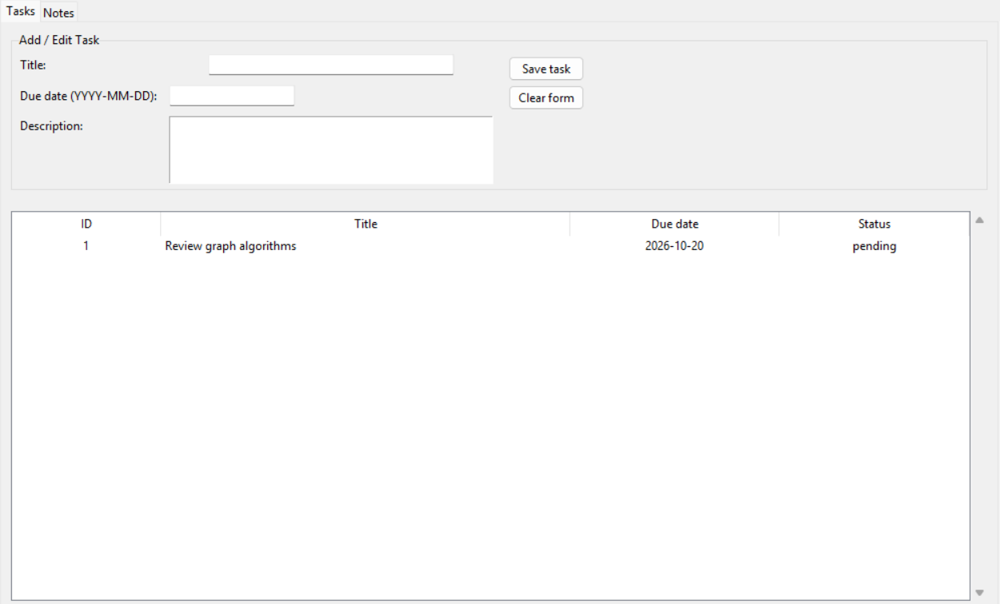

# Smart Study Assistant

A Python desktop application for organizing study tasks and notes. Its Tkinter interface has separate Tasks and Notes tabs, while SQLite stores the data locally.



*Screenshot captured with demonstration data.*

## Main parts

- `app.py` starts the interface and opens the database.
- `ui/tasks_view.py` adds, lists, completes, and deletes tasks.
- `ui/notes_view.py` manages notes and can save an AI-generated summary to a file.
- `db/database.py` creates the SQLite tables and manages connections.
- `ai/summarizer.py` uses a Hugging Face model to summarize notes. The model is downloaded on first use, then can work offline.
- `ai/task_parser.py` contains a separate natural-language task parser using the OpenAI API; it is not connected to the main interface.

## Run

From this folder, run:

```sh
python app.py
```

Use a Python installation with Tkinter. The application creates a local `smart_study.db` file on first run; this file is ignored by Git so your notes and tasks stay local. For note summarization, install `transformers` and `torch` with `python -m pip install transformers torch`; the rest of the app can run without them. The optional task parser requires the `openai` package, an `OPENAI_API_KEY`, and compatibility with the API call used in that file.
